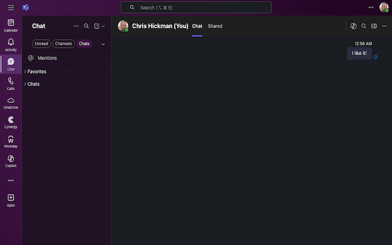

  
# Themes for Teams - Chrome, Firefox and Edge Extension

I work for a company that recently migrated to Teams.  

I decided to build a browser extension to improve the overall experience and make Teams feel like home - more like the friendlier chat app I came from.

## Features

Everything is a setting. Open the popup to switch each tweak on or off, or start from a preset: **Recommended** (the author's look), **Streamlined** (flat, tight, hover-highlighted messages) or **Teams default** (every tweak off). Presets never change your theme or font. Settings that only apply to Teams' Comfy message density are hidden while you use Compact.

Apps Teams embeds from other Microsoft sites, like Calendar and OneDrive/SharePoint files, keep their own look.

- Look: theme, font, avatar shape, text size, borders
- Links: link color, mention chips, Teams link and external link styles
- Messages: my messages, flat messages, hover highlight, chat background, timestamps, reply summary, reactions, spacing, day dividers
- Layout: wider and rounded chat list, roomier Threads pane, all chat filters, expanded posts, list density
- Code & media: code colors and size, image and card borders
- Distractions: hide Copilot buttons, see-through notifications
- Motion: turn animations off

## Chrome Installation

[Install from the Chrome Web Store](https://chromewebstore.google.com/detail/themes-for-teams/odimdoddkdpnifojkpgcmcgehlkdjakj)

Or Manually Install:

1. Visit: chrome://extensions/
2. Enable Developer Mode (top right!)
3. Click 'Load Unpacked'
4. Select the folder you unzipped this to that contains manifest.json
5. Reclaim your wasted screen real estate!

## Firefox Installation

[Install from Firefox Browser Add-Ons](https://addons.mozilla.org/en-US/firefox/addon/themes-for-teams/)

Or Manually Install:

1. Visit: about:debugging
2. Click 'This Firefox' on the left.
3. 'Load Temporary Add-On'.
4. Select the manifest.json from this repo.
5. Temporary add-ons are removed when Firefox restarts — use the Add-Ons link above for a permanent install.

## Edge Installation

Edge installs Chrome Web Store extensions: [Install from the Chrome Web Store](https://chromewebstore.google.com/detail/themes-for-teams/odimdoddkdpnifojkpgcmcgehlkdjakj). Edge will ask you to 'Allow extensions from other stores' - say yes.

Or Manually Install:

1. Visit: edge://extensions/
2. Enable Developer Mode
3. Click 'Load Unpacked'
4. Select the folder you unzipped this to that contains manifest.json

## Development

Run `node tools/check-settings.mjs` to check that styles.css and settings.js agree.

## Changelog

v0.5.0
  - Supports Teams' new address, teams.cloud.microsoft (thanks @ArnoVerstraete)
  - Channel thread replies restyled for Teams' Threads layout
  - Removed rules for the retired Posts channel layout, and padding rules that narrowed the message pane now that Teams is full-width itself
  - Fix: San Francisco Pro font option now works
  - Every tweak is now a setting, with Recommended, Streamlined and Teams default presets, plus step-by-step Undo
  - Themes: retired Cosmic, Rose, Ocean and Sunset; new Nord, Tokyo Night, Gruvbox and Catppuccin (palettes from those MIT-licensed projects), and a deliberately awful Hot Dog Stand for Windows 3.1 fans
  - New: text size, link/mention/Teams-link styles, external-link icon, message spacing, day-divider pills, flat messages, hover highlight, chat backgrounds (doodles, dots, graph paper, honeycomb, waves, plus, tartan, arabesque, confetti) with glassy message surfaces, compact chat list, hide Copilot buttons
  - Fix: Disable Animations now also stops menu and popover animations
  - Fix: subtle divider between a channel and its Threads pane is back; Threads pane gets breathing room

v0.4.1
  - Fix: Code block line numbers now display correctly - no overlap or drift

v0.4.0
  - New: Disable Animations option - eliminates 246 CSS transitions for a snappier UI
  - Performance: Eliminated redundant CSS loading (styles.css was being loaded 3x per page)
  - Fix: Message pane padding selector now correctly targets the right container
  - Fix: Compose area full-width selector now targets the footer

v0.3.6
  - Added gap above embedded content (1em)
  - Removed padding on sides of channels again (compatible with Threads)

v0.3.5
  - Fixes many spacing issues caused by Threads update
  - New Extension Icon
  - Themed Theme Selector
  - Subtle border around images - fixes 'weirdness' if image has blank pixels above/below

v0.3.4
  - Automatically show 'Meeting Chats' filter in left column
  - Remove filters 'expand' icon (no longer needed)
  - Automatically expand posts, remove See More / See Less
  - Message replies - added 3px left blue border to visually tie replies to message.
  - Embedded Content - Smaller footer text, small rounded border, removed left blue border
  - Default code block text color -> white (inline code remains orange)

v0.3.3
  - Set code font to 85% size.
  - Improved TypeScript / JavaScript Codeblock colors
  - Improved avatar/name/timestamp in chats.
  - Subtle transparency on notification overlays
  - Prefix -your- chat messages with 'You' (left aligned)

v0.3.2
  - Deeper "Purple" Theme
  - Orange Code Blocks
  - Fixes Comic Sans (by popular request)

v0.3.1
  - Fixes channel reply width

v0.3.0 
  - Simplified themes to color values to use with base theme.
  - Added more themes!
  - Avatars are now rounded squares, not circles.

v0.2.0
  - Supports Light Mode!

v0.1.4
  - Handles long titles with full width, no wrap, ellipses ...
  - Font Smoothing

v0.1.1 
  - Fixed click target area on replies for emojis

v0.1.0 - Beta
  - Gradient UI borders, more tweaks, better themes.  Supports Firefox.

v0.0.1 - Alpha
  - Widened Chats, Channels, Reduced Team/Channel List gutter and set default font to Lato

